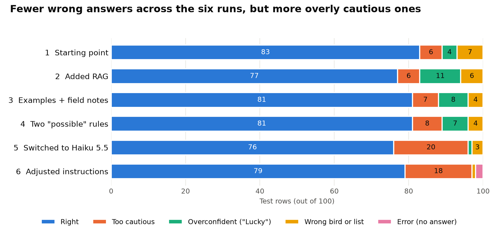

# Fowl Play: materials for the written report

Everything here comes from the project's code, Git history and saved evaluation
results. All counts are out of 100 test rows unless it says otherwise.

Files in this folder:

- `verdicts_by_run.png`: chart of the six evaluation runs, ready to paste.
- `row_by_row.csv`: every test row with its verdict in all six runs.

## 1. Check these before you submit

1. **22 of the 100 test rows are marked as not fully checked.** Their `source`
   column in `eval/test_cases.csv` says "Claude draft from field-guide
   knowledge; eBird page could not be read, check against a field guide". The
   other 78 say "Field marks checked against eBird species account". Either
   check the 22 against a field guide or say in the report that they were not
   checked. They are labelled in the `source_status` column of `row_by_row.csv`.
   (The app was right on 19 of those 22 in the final run, and 60 of the other 78.)
2. **Quote the final score as 79 of 100.** The script prints 81% because it
   leaves out the 2 rows that got an error instead of an answer.
3. **The final score is not higher than the starting score.** It went from 83
   to 79. The real gain is in the worst errors, which fell from 7 to 1 (section 7).
4. **If your course asks you to declare AI help,** this project was built with
   Claude Code, and part of the test data is marked as a Claude draft.
5. **The online version is not up yet.** Step 21 is still to do.

## 2. What the app does

Fowl Play is a Streamlit web app that identifies a bird from a plain-language
description. The user must give a location and at least one description of the
bird. The app gives one of three answers:

| Answer | Meaning | What is shown |
|---|---|---|
| Confident | The description rules out all similar species | One species, Wikipedia photo and summary |
| Possible matches | 2 or 3 species remain | Up to 3 species, each with a photo, plus an "AI suggestion" for telling them apart |
| Not enough data | More than 3 species remain | "Not enough data to make an identification" |

What happens when the user clicks Identify:

1. The filled-in boxes are joined into one labelled text.
2. `rag.py` looks for matching field records.
3. Claude Haiku 5.5 receives the text, any records, and its instructions, which
   are the skill file plus the owner's field notes.
4. Haiku must reply in a fixed format (structured output). It writes its
   reasoning first, then the outcome, then the species.
5. Every species name is checked against AviList v2025b (11,131 species). A name
   that isn't on the list is not shown as a real identification.
6. Photos and summaries come from Wikipedia, looked up by scientific name. Haiku
   does not write them, and no images are AI-generated.

Without an API key the app runs in demo mode: fake answers in the same format,
at no cost.

## 3. The SKILL.md file

**Where it is:** `.claude/skills/identify-bird/SKILL.md`. The folder starts with
a dot, so it can be hidden in Finder. Give its full path in the report.

**What it is:** a Claude Code skill, which is a file of instructions for one
specific job. The part between the `---` lines holds its name and a description
that tells Claude Code when to use it. The rest is the instructions.

**Why it is useful here:** one file does two jobs. `bird_identifier.py` reads it
as Haiku's instructions, and Claude Code can run it directly as `/identify-bird`.
So there is one copy of the rules to maintain.

**What it contains:**

- The rule for choosing between the three outcomes, based on how many species remain.
- Reason before deciding: list the look-alikes, and name the detail that rules
  each one out.
- Use only details the user actually wrote.
- How to treat field records: as facts about that record's species only.
- Name format (AviList, "Genus species").
- Three worked examples: a cautious answer (three hawks in Ohio), a confident
  answer (Black-winged Stilt in Gujarat), and a decline (greenish bird in Kerala).

**Limits when it runs as a Claude Code skill:** it has the rules only. The field
notes, field records, fixed reply format, name check and Wikipedia lookup are all
added by the app's code.

**How the instructions changed:**

| Stage | Change | Commit |
|---|---|---|
| Run 1 | Original instructions, written inside `bird_identifier.py` | `2d10dd0` |
| Run 2 | Paragraph added on how to treat field records | `4860485` |
| Before run 3 | Moved word for word into SKILL.md, with no change in wording | `b9f5188` |
| Run 3 | Three worked examples, and the field notes added after the instructions | `3019c6c` |
| Run 4 | Two rules for choosing "possible" | `1470fe1` |
| Run 6 | "not_enough over possible" removed; first run 4 rule removed; only realistic look-alikes count; species must always be listed | `d19068c` |

## 4. The RAG sample

RAG (retrieval-augmented generation) means finding relevant stored text and
giving it to the AI along with the question.

- **Knowledge:** seven field records written by the owner, kept exactly as
  written, in `data/field_records.txt`: Jungle Babbler, Red-vented Bulbul, Indian
  Peafowl (male), Plum-headed Parakeet, Pied Kingfisher, Black Drongo and
  Red-wattled Lapwing.
- **Retrieval:** `rag.py` counts the meaningful words each record shares with the
  description. A record needs at least 4 shared words, and the best 2 are used.
- **On the page:** a caption says "Checked using RAG against field records" and
  names the records used.
- **Why no embeddings:** embeddings (turning text into numbers that capture
  meaning) were tested with two models on the test descriptions and did no
  better. No cut-off separated matching records from unrelated ones, because bird
  descriptions all use similar words. Word matching is also simpler to explain.

## 5. How the evaluation works

`eval/run_eval.py` sends each test row through the same function the app uses,
then gives it one verdict.

| Expected | App said | Verdict |
|---|---|---|
| confident | confident, right species | Correct |
| confident | possible, right species in the list | Too cautious |
| possible | possible, right species in the list | Correct |
| possible | confident, right species | Lucky (overconfident) |
| not enough | not enough | Correctly declined |
| any answer | not enough | Too cautious |
| any answer | right species missing | **Wrong** |
| not enough | confident or possible | **Guessed** |

Only Correct and Correctly declined count as right. Wrong and Guessed are the
"worst errors", because the app is misleading the user.

**The test list:** 100 rows covering 50 species, in `eval/test_cases.csv`.

- 50 rows are expected to be confident, 25 possible and 25 not enough data.
- Row IDs end in C, V or N to match those three groups. The number is the bird,
  so `13-C` and `13-V` are both Black Kite at different levels of detail.
- The script checks every expected species against AviList before it runs.
- Row numbers in the score history are positions from 1 to 100. `row_by_row.csv`
  gives both the position and the ID.

## 6. Results

| Run | Change | Model | Right | Correct | Declined | Too cautious | Lucky | Wrong | Error |
|---|---|---|---|---|---|---|---|---|---|
| 1 | Starting point | Haiku 4.5 | **83** | 58 | 25 | 6 | 4 | 7 | 0 |
| 2 | Added RAG | Haiku 4.5 | **77** | 52 | 25 | 6 | 11 | 6 | 0 |
| 3 | Worked examples and field notes | Haiku 4.5 | **81** | 56 | 25 | 7 | 8 | 4 | 0 |
| 4 | Two "possible" rules | Haiku 4.5 | **81** | 56 | 25 | 8 | 7 | 4 | 0 |
| 5 | Switched model | Haiku 5.5 | **76** | 51 | 25 | 20 | 1 | 3 | 0 |
| 6 | Instructions adjusted for 5.5 | Haiku 5.5 | **79** | 54 | 25 | 18 | 0 | 1 | 2 |

No run had any Guessed rows. The margin of error on a single run is about ±8 points.

**Right answers by expected outcome:**

| Expected | Run 1 | Run 2 | Run 3 | Run 4 | Run 5 | Run 6 |
|---|---|---|---|---|---|---|
| Confident (of 50) | 47 | 46 | 46 | 45 | 38 | 43 |
| Possible (of 25) | 11 | 6 | 10 | 11 | 13 | 11 |
| Not enough (of 25) | 25 | 25 | 25 | 25 | 25 | 25 |

**What the app answered, first run against final run:**

| Expected | Run 1: confident / possible / not enough | Run 6: confident / possible / not enough / error |
|---|---|---|
| confident | 49 / 1 / 0 | 44 / 4 / 1 / 1 |
| possible | 5 / 14 / 6 | 0 / 11 / 13 / 1 |
| not enough | 0 / 0 / 25 | 0 / 0 / 25 / 0 |

In run 1, 3 of the 14 "possible" answers to possible rows did not include the
true bird, so 11 count as right.

**Rows that changed between consecutive runs:**

| Step | Became right | Stopped being right |
|---|---|---|
| Run 1 to 2 | 3 | 9 |
| Run 2 to 3 | 9 | 5 |
| Run 3 to 4 | 4 | 4 |
| Run 4 to 5 | 11 | 16 |
| Run 5 to 6 | 8 | 5 |

The notes for each run are in `eval/score_history.md`.

## 7. What the results show

- **Overall accuracy did not measurably change.** From run 1 to run 6, 9 rows
  became right and 13 stopped being right. A sign test asks how likely a split
  like that is if each change were a coin flip. Here p = 0.52, so it could easily
  be chance.
- **The worst errors did fall.** All 7 Wrong rows from run 1 were cleared except
  row 11, and no new row became Wrong by the final run. For 6 rows fixed and 0
  new, the sign test gives p = 0.03. This is one of several comparisons, so treat
  it as promising rather than proven.
- **The drop came with a trade-off.** Too cautious rose from 6 to 18. The final
  app rarely misleads, and it declines or hedges more often.
- **Haiku 5.5 was the biggest behaviour change.** Too cautious went from 8 to 20
  and Lucky from 7 to 1 in one step, with no change to the instructions.
- **Saying "not enough" when it should is the strongest area.** It was right on
  25 of 25 in every run, and never guessed.
- **"Possible" is the weakest area.** It stayed between 6 and 13 of 25. In the
  final run, 13 possible rows were answered "not enough data", and none were
  answered "confident". The problem moved from overconfidence to overcaution.
- **Results are stable at the extremes and unstable in the middle.** 58 rows were
  right in all six runs (33 confident, 25 not enough). 39 rows changed, including
  23 of the 25 possible rows. 3 rows were never right: `13-C` and `13-V` (Black
  Kite) and `17-V` (Spoon-billed Sandpiper).

**RAG specifically:**

- The score fell from 83 to 77 when RAG was added, but the instructions also
  gained a paragraph in that run, so the two effects can't be separated.
- Rows with no record also fell, from 38 to 34 of 49, and they received the same
  description as before. So at least part of that drop was not caused by records.
- **Retrieval was mostly off target on this test list.** In the final run, 50
  rows received at least one record, and only 3 of those included the right
  bird's record. The other 47 received records for unrelated birds.
- Only 2 of the 7 record species appear in the test list (4 rows). Black Drongo
  was never retrieved in the final run.
- The script's "88% right" for rows with a record does not show that RAG helps.
  46 of those 50 rows were expected to be confident, a group the app does well
  on anyway.
- Row 11 (Common Myna, answered Yellow-wattled Lapwing) received the Red-wattled
  Lapwing record, so RAG may have pulled it towards a lapwing. This can't be proven
  from one run.

As a sample of how RAG works, it does its job. The evaluation doesn't show that
it improved identification, and the test list wasn't designed to test it.

## 8. Remaining mistakes in the final run

| Type | Rows | Detail |
|---|---|---|
| Wrong (1) | `11-C` | Common Myna answered as Yellow-wattled Lapwing |
| Possible instead of confident (4) | `12-C`, `13-C`, `42-C`, `49-C` | Right bird was in the list: Red-vented Bulbul, Black Kite, North Island Brown Kiwi, Great Indian Bustard |
| Not enough instead of confident (1) | `03-C` | Rock Pigeon |
| Not enough instead of possible (13) | `01-V`, `02-V`, `04-V`, `05-V`, `08-V`, `09-V`, `13-V`, `15-V`, `17-V`, `21-V`, `22-V`, `31-V`, `50-V` | App felt more than 3 species remained |
| Error (2) | `05-C`, `19-V` | American Robin and Great Tit got the friendly error message |

In `13-C`, one suggested name (Black-eared Kite, *Milvus lineatus*) failed the
name check, so the check did catch a name that isn't on AviList.

## 9. Limits to state honestly

- **The instructions were tuned on the same 100 rows used to score them,** with
  no separate test set. The scores may be optimistic for new descriptions.
- **Each setup was run only once.** Runs 1 to 4 used temperature 0 (the most
  repeatable setting). Haiku 5.5 doesn't accept that setting, so runs 5 and 6 can
  vary even with nothing changed. How much they vary was not measured.
- **Some runs changed more than one thing.** Run 2 added records and an
  instruction paragraph. Run 5 changed the model and its settings (temperature
  removed, longer reply limit, effort setting added). Run 6 made four instruction
  changes together. Those effects can't be separated.
- **Small differences mean little.** With about ±8 points of margin, most
  run-to-run changes are within ordinary variation.
- **Expected answers are judgment calls,** especially how many look-alikes
  "remain" on the possible rows. 22 rows are also unchecked (section 1).
- **Written descriptions only.** The test rows are not reports from real users
  in the field.
- **Not evaluated:** whether Wikipedia photos and summaries are right, how usable
  the page is, and cost per identification (usage wasn't recorded).

## 10. Where to find everything

| What | Where |
|---|---|
| Skill and Haiku's instructions | `.claude/skills/identify-bird/SKILL.md` |
| Project overview and how to run it | `README.md` |
| Run-by-run notes | `eval/score_history.md` |
| Test list | `eval/test_cases.csv` |
| Evaluation script | `eval/run_eval.py` |
| Full results of each run, including Haiku's reasoning | `eval/results_real_*.csv` |
| Identification logic | `bird_identifier.py` |
| RAG code and records | `rag.py`, `data/field_records.txt` |
| Name check and checklist source | `name_check.py`, `data/README.md` |
| Build plan and progress | `PLAN.md` |

Results files and their code:

| Run | Results file | Commit |
|---|---|---|
| 1 | `results_real_2026-10-20_2014.csv` | `2d10dd0` |
| 2 | `results_real_2026-11-09_0058.csv` | `4860485` |
| 3 | `results_real_2026-11-09_0120.csv` | `3019c6c` |
| 4 | `results_real_2026-11-09_0129.csv` | `1470fe1` |
| 5 | `results_real_2026-11-09_0208.csv` | `1878179` |
| 6 | `results_real_2026-11-09_0218.csv` | `d19068c` |

**Sources to cite:** AviList Core Team. 2026. AviList: The Global Avian Checklist,
v2025b. https://doi.org/10.2173/avilist.v2025b. Field marks checked against eBird
(Cornell Lab), October 2026. Photos and summaries from Wikipedia.
